# BerlinStay Pricing Intelligence

[](https://github.com/UDAY2003/berlinstay-pricing-intelligence/actions/workflows/ci.yml)
   

> How should a host or small property manager in Berlin price a listing, what income is realistic, and how do seasonality and local rules change that?

An end-to-end analytics project on public [Inside Airbnb](http://insideairbnb.com/get-the-data/) data for Berlin (12,376 listings, 4.5M calendar rows, 709k reviews), built in three releases that each upgrade the last: **SQL/BI analytics -> dbt + pricing model + scenarios -> a Streamlit app with a safe text-to-SQL assistant.**

**Live app:** _not deployed yet - add your Streamlit Community Cloud URL here ([steps](docs/DEPLOY.md))_ | **Case study:** [docs/CASE_STUDY.md](docs/CASE_STUDY.md) | **Memo for hosts:** [docs/MEMO_V2.md](docs/MEMO_V2.md)

| Market Explorer | Price Estimator |
|---|---|
| 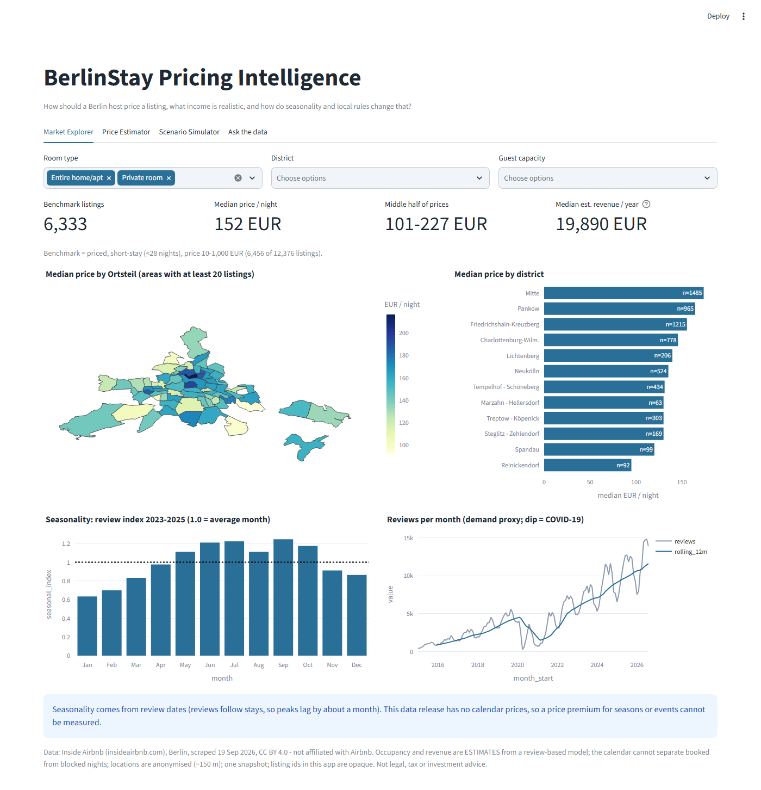 | 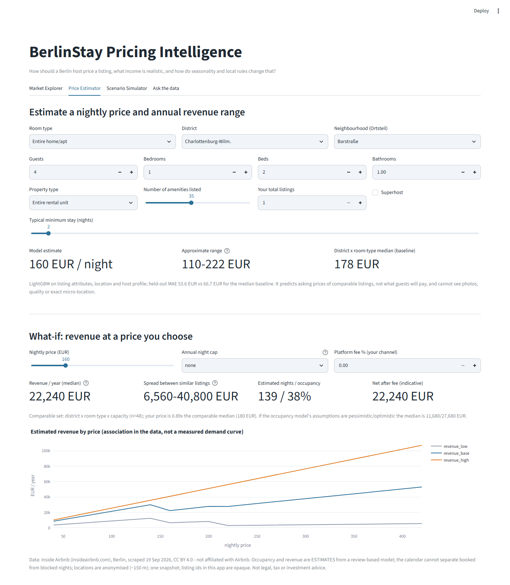 |
| **Scenario Simulator** | **Ask the data (demo mode, no key needed)** |
| 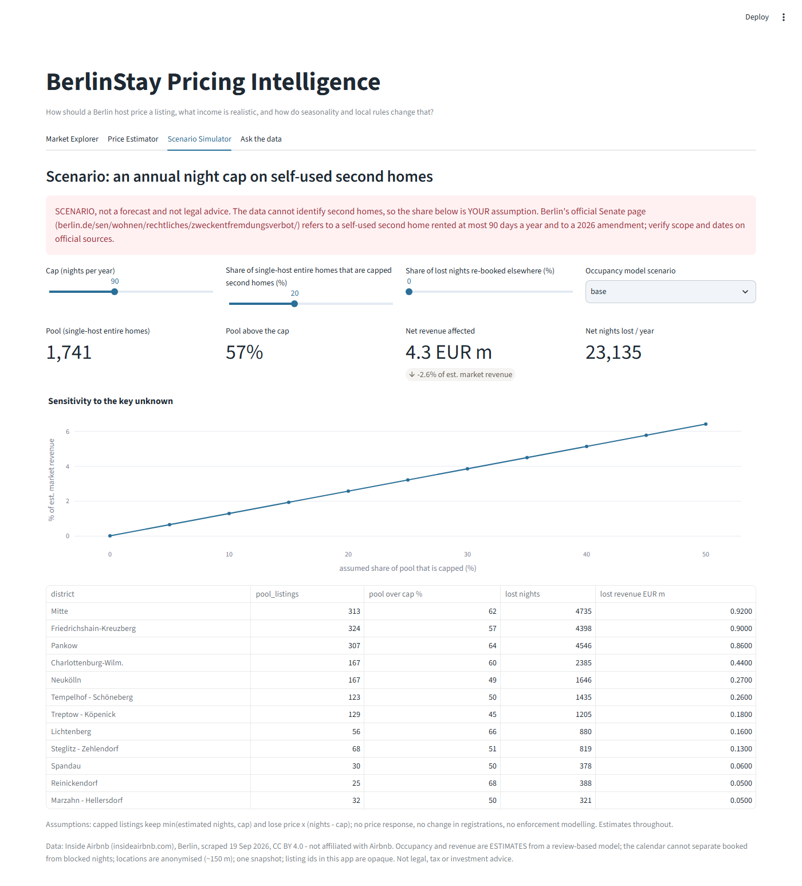 |  |

## Quick start (no data download needed)
The app runs from a 2.3 MB committed sample and a saved model.
```bash
git clone https://github.com/UDAY2003/berlinstay-pricing-intelligence && cd berlinstay-pricing-intelligence
pip install -r app/requirements.txt
streamlit run app/streamlit_app.py
```
Windows PowerShell without activating a venv: `python -m venv venv; .\venv\Scripts\python.exe -m pip install -r app\requirements.txt; .\venv\Scripts\python.exe -m streamlit run app\streamlit_app.py`

## What is in it
| Release | Content |
|---|---|
| **V1 Market Analytics** | DuckDB star schema, 15 SQL files (CTEs, window functions), generated data-quality report, EDA notebook, Power BI build guide with DAX and expected values, memo |
| **V2 Pricing and Scenarios** | dbt-duckdb models (staging -> intermediate -> marts, 44 tests) reconciled against V1, LightGBM price model vs a median baseline, revenue what-if calculator, 90-night-cap scenario |
| **V3 AI Pricing Assistant** | Streamlit app (4 tabs), text-to-SQL with a layered safety design, 42-question evaluation harness, deploy guide |

## Key findings (estimates are marked)
- **Market:** only 52% of listings are priced short-stay listings (6,456); 34% have no price, 13.5% are mid-term (28+ nights). Hosts with 4+ listings: about 10% of hosts, 42% of listings, 47% of estimated revenue.
- **Prices:** median **181 EUR/night** for entire homes (middle half 135-256) and **91 EUR** for private rooms; Mitte highest (205), Reinickendorf lowest (115).
- **Income (estimate, gross):** median entire home **16.8k / 26.0k / 29.1k EUR per year** (low / base / high). The mean is about 31% above the median; the top 10% of listings earn about a third of revenue.
- **Seasonality (review proxy):** strongest September, July, June, October; weakest January-February. Review activity Jan-Aug 2026 is +15.4% vs 2025. The calendar has no prices, so price premiums cannot be measured.
- **Price model:** on hosts it never saw, **MAE 53.6 EUR vs 66.7 EUR** for the district x room-type median (95% CI of the difference -15.8 to -10.5). It is **not better** for private rooms or the 150-250 EUR band, and its 80% range covers 72% ([report](docs/PRICE_MODEL_REPORT.md)).
- **90-night cap (scenario, not legal advice):** if 20% of single-host entire homes were capped second homes, about 2.6% of estimated market revenue would be affected ([scenario](docs/REGULATION_SCENARIO.md)).
- **Assistant safety:** the LLM writes SQL but is never trusted: one SELECT validated by DuckDB's parser, table allow-list, locked in-memory database with no file access, 200-row limit, 8 s timeout; 36 of 36 attack strings blocked in tests.

## Results gallery
**Market (V1)**

| | |
|---|---|
| 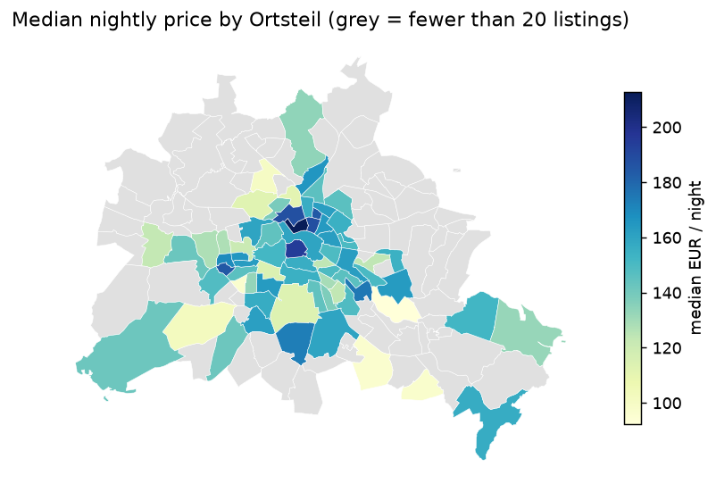<br>**Where prices are high:** median nightly price by neighbourhood; the centre (Mitte, Prenzlauer Berg) is dearest, areas with under 20 listings are greyed out. | 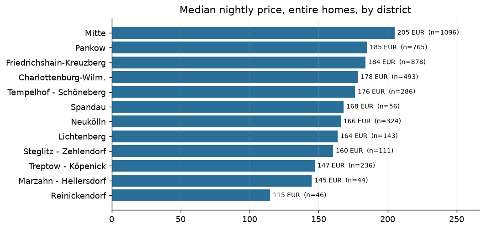<br>**Entire homes by district:** Mitte 205 EUR down to Reinickendorf 115 EUR; sample sizes shown. |
| 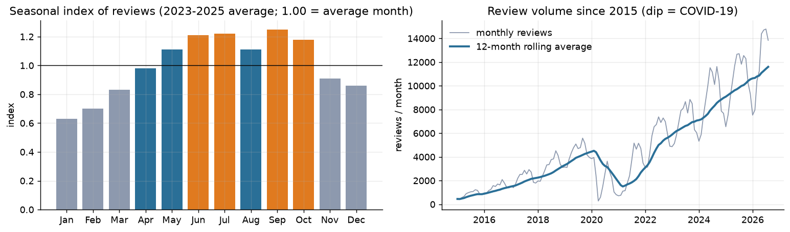<br>**Seasonality (review proxy):** September, July, June, October strongest; January weakest (index 0.63). The 2020 dip is COVID-19. | 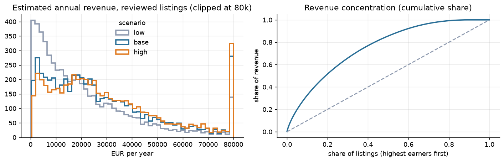<br>**Estimated income is skewed:** median 19.6k vs mean 25.7k EUR/year; the top 10% of listings earn about a third of revenue. Low/base/high = model uncertainty. |
| 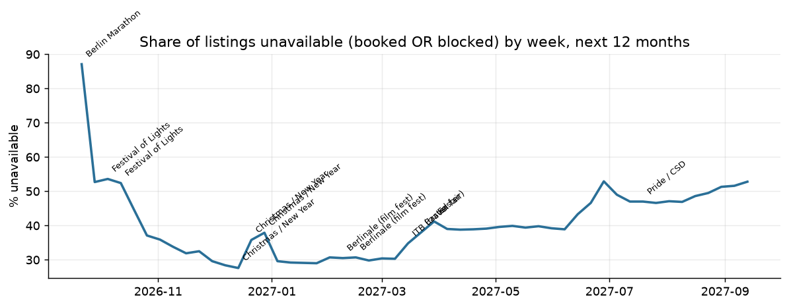<br>**Forward calendar:** share of nights booked or blocked by week, with event labels. Mixes seasonality with booking lead time, so read it as directional. | 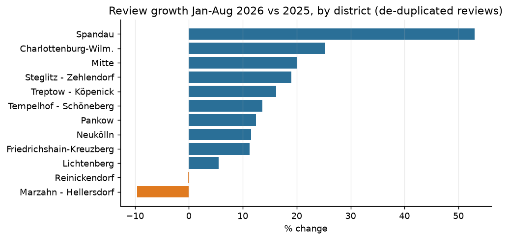<br>**Demand growth Jan-Aug 2026 vs 2025:** 10 of 12 districts grew (de-duplicated reviews); small districts have small bases. |

**Pricing model and scenario (V2)**

| | |
|---|---|
| 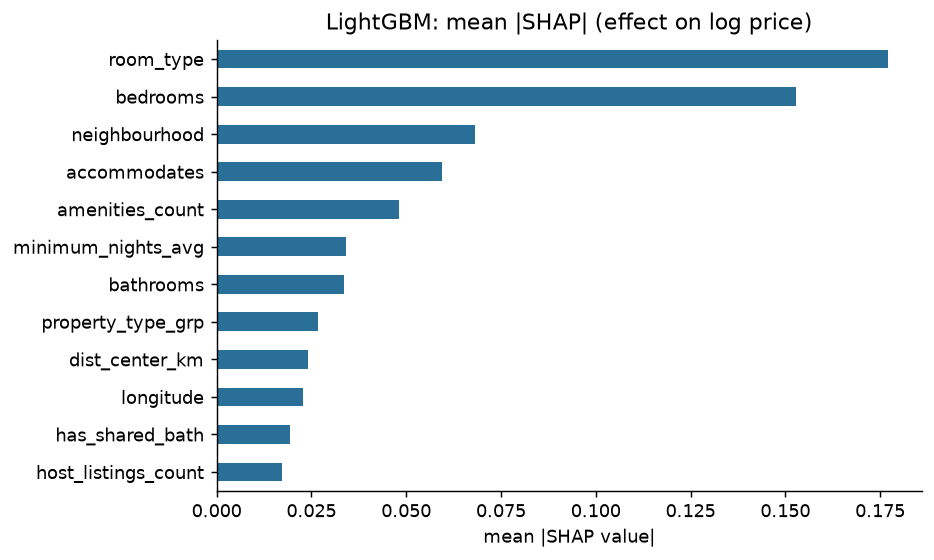<br>**What drives the predicted price:** room type, bedrooms, neighbourhood and guest capacity (mean absolute SHAP on log price). | 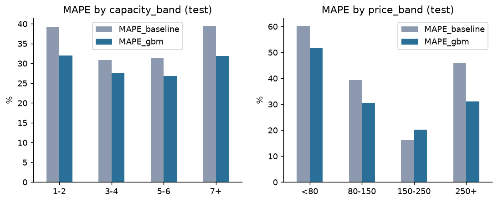<br>**Where the model helps and where it does not:** MAPE by capacity and price band, baseline vs LightGBM, on hosts the model never saw. |
| 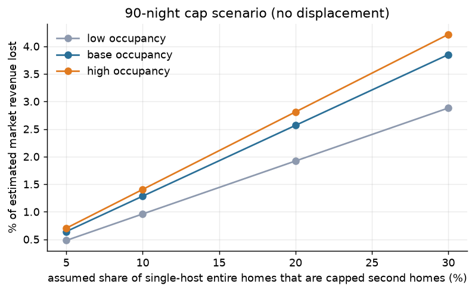<br>**90-night-cap scenario:** share of estimated market revenue affected vs the assumed share of capped second homes (about 2.6% at 20%). A scenario, not a forecast. | 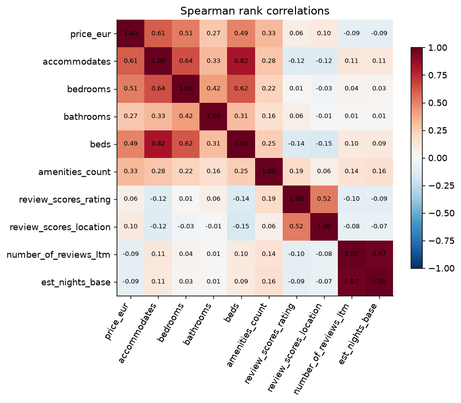<br>**What correlates with price:** guest capacity (0.61), bedrooms (0.51), beds (0.49); review scores barely (0.06). |

**Data model, lineage and tests**
- dbt lineage diagram (generated from the real manifest, renders on GitHub): [docs/DBT_LINEAGE.md](docs/DBT_LINEAGE.md); table grain and keys: [docs/DATA_MODEL.md](docs/DATA_MODEL.md); V1 vs dbt reconciliation: [docs/V1_V2_RECONCILIATION.md](docs/V1_V2_RECONCILIATION.md).
- Committed result tables: [reports/](reports/README.md) (all 11 SQL answers, model metrics, scenario tables). Executed EDA notebook: [notebooks/01_eda.ipynb](notebooks/01_eda.ipynb).
- **Power BI:** the dashboard is built from `powerbi/` using [docs/POWERBI_GUIDE.md](docs/POWERBI_GUIDE.md); dashboard screenshots are not part of this repo yet.

## Architecture
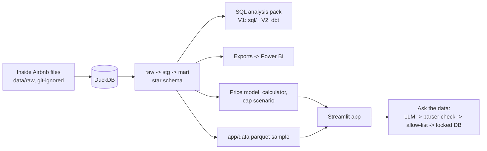

## Reproduce everything
```bash
python -m venv venv && source venv/Scripts/activate      # Git Bash; Python 3.13 used here
pip install -r requirements.txt
# put the 5 Inside Airbnb files (scrape 2026-09-19) in data/raw/ :
#   listings.csv.gz, calendar.csv.gz, reviews.csv.gz, neighbourhoods.csv, neighbourhoods.geojson
#   https://data.insideairbnb.com/germany/be/berlin/2026-09-19/data/listings.csv.gz  (same folder: calendar, reviews;
#   .../visualisations/neighbourhoods.csv and .geojson)
bash scripts/check.sh                 # rebuild V1+dbt+model+scenario+app data, Power BI reference values, tests (PowerShell: .\scripts\check.ps1)
```
Or step by step: `python -m src.run_pipeline` (V1, about 25 s), `python -m src.run_v2` (everything incl. dbt and model), `python -m src.build_app_data`, `python -m pytest -q tests` (117 tests; the ones needing the database skip when it is absent, as in CI).

dbt docs and lineage: `cd dbt_project && dbt docs generate --profiles-dir . && dbt docs serve --profiles-dir .`

## Verification status
| Item | Status |
|---|---|
| Automated tests | 117 pass locally; CI runs the ones that need no database and passed on GitHub |
| dbt | 73 nodes pass (29 models/seeds, 44 tests); 19 of 19 tables reconcile with V1 |
| Power BI guide | **DAX not executed** (Power BI not available when this was built). Every one of the 30 measures has a pandas reference value ([docs/POWERBI_EXPECTED_VALUES.md](docs/POWERBI_EXPECTED_VALUES.md)) and tests keep guide and values in sync |
| LLM assistant accuracy | **not yet measured** (needs a funded API key). Harness verified: a scripted perfect model scores 100%, a constant-answer model scores ~0; run `python -m eval.run_eval --provider env` ([docs/EVAL.md](docs/EVAL.md)) |
| Event dates (cap/event analysis) | checked against official sources on 2026-11-23 |

## Repo map
| Path | What |
|---|---|
| `sql/`, `src/` | V1 SQL build and analysis, loader, pipeline, data-quality report, exports |
| `dbt_project/` | V2 dbt-duckdb models, seeds, tests |
| `src/features.py`, `src/price_model.py`, `models/` | features, model training, saved model |
| `src/revenue_calculator.py`, `src/scenario_cap.py` | what-if tool, cap scenario |
| `app/`, `src/text2sql/`, `src/predict.py` | Streamlit app, safe text-to-SQL, single-listing prediction |
| `eval/` | 42-question evaluation set and scoring script |
| `tests/` | pytest suite (data model, model, safety, app smoke test, Power BI) |
| `notebooks/01_eda.ipynb`, `powerbi/` | EDA with takeaways; CSVs for Power BI |
| `docs/` | data model, quality report, memos, case study, model report, scenario, Power BI guide and expected values, evaluation, deploy, CV bullets, learning notes |
| `scripts/`, `.github/workflows/ci.yml` | one-command check, CI |

## Honest limits
Occupancy and revenue are **estimates** (review-rate model, reconciled to Inside Airbnb's own estimate). The calendar cannot separate booked from blocked nights and has **no prices** in this release. Locations are anonymised (~150 m); one snapshot (19 Sep 2026); results are aggregated and no host is identified. Nothing here is legal, tax or investment advice; regulatory points must be verified with official sources.

## License and data credit
Code and documentation: MIT ([LICENSE](LICENSE)). Data: [Inside Airbnb](http://insideairbnb.com/get-the-data/), Berlin, scraped 19 Sep 2026, **CC BY 4.0** - keep the attribution when reusing. Not affiliated with or endorsed by Inside Airbnb or Airbnb.
