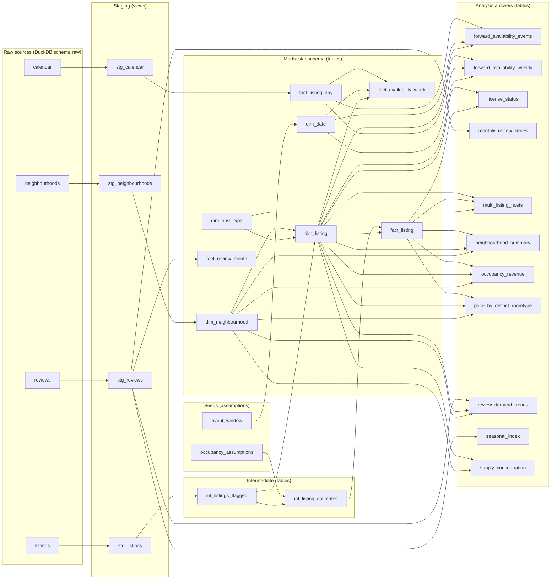

# dbt lineage (generated)

Generated from `dbt_project/target/manifest.json` by `python -m src.dbt_lineage`. Arrows point from an input to the model that uses it.

25 models, 2 seeds, 4 sources, 46 dependencies. Tests (44) are defined in `models/*/schema.yml` and `dbt_project/tests/`.
