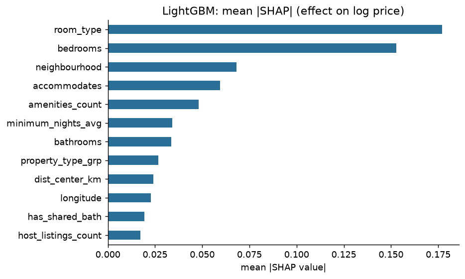
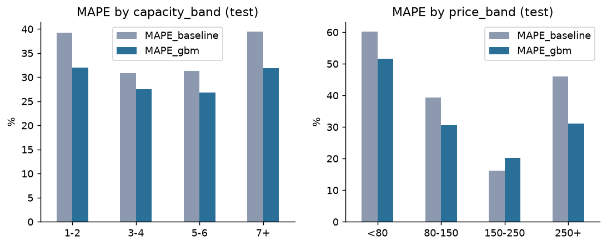

# Price model report (V2)

Generated by `python -m src.price_model`. Target: nightly price (EUR) of benchmark listings (priced, short-stay, 10-1,000 EUR). Train 5,152 / test 1,304 listings, split **by host** so no host appears on both sides. All tuning on train only (GroupKFold, 5 folds); test used once.

## Metrics

| Model | CV MAE | CV MAPE % | Test MAE (EUR) | Test MAPE % | Test median APE % | Test R2 (log) | Test bias (EUR) |
|---|---|---|---|---|---|---|---|
| Baseline: district x room-type median | 69.5 | 37.4 | 66.7 | 35.8 | 28.5 | 0.30 | -26.2 |
| Baseline+: district x room-type x capacity median | 60.4 | 33.5 | 60.8 | 32.5 | 26.4 | 0.41 | -18.9 |
| LightGBM (listing-only features) | 55.2 | 31.0 | 53.6 | 30.0 | 22.3 | 0.53 | -11.2 |
| LightGBM + review/performance features (ablation) | 52.5 | 28.8 | 50.2 | 27.8 | 20.5 | 0.58 | -10.3 |

## Does the model beat the baseline? (paired bootstrap on test MAE, 2,000 resamples)

- **LightGBM (listing-only features) minus Baseline: district x room-type median**: mean MAE difference -13.1 EUR, 95% CI [-15.8, -10.5], share of resamples where the model is better 100%.
- **LightGBM (listing-only features) minus Baseline+: district x room-type x capacity median**: mean MAE difference -7.2 EUR, 95% CI [-9.3, -5.1], share of resamples where the model is better 100%.

**Reading:** on unseen hosts the LightGBM model has MAE 53.6 EUR vs 66.7 EUR for the district x room-type median (20% lower) and MAPE 30.0% vs 35.8%. Whether the improvement is reliable is decided by the bootstrap interval above, not by the point estimate.

80% prediction interval (q10-q90 quantile models): empirical test coverage **72%** (nominal 80%), median width 116 EUR.

## Best hyper-parameters (random search, 14 trials)

`{'num_leaves': 31, 'min_child_samples': 40, 'learning_rate': 0.03, 'n_estimators': 200, 'colsample_bytree': 1.0, 'subsample': 0.9, 'reg_lambda': 1, 'subsample_freq': 1}`

## Feature importance (mean |SHAP|, effect on log price)

| Feature | mean abs SHAP |
|---|---|
| room_type | 0.177 |
| bedrooms | 0.153 |
| neighbourhood | 0.068 |
| accommodates | 0.059 |
| amenities_count | 0.048 |
| minimum_nights_avg | 0.034 |
| bathrooms | 0.034 |
| property_type_grp | 0.027 |
| dist_center_km | 0.024 |
| longitude | 0.023 |

## Error analysis by segment (test set)

| Segment | Level | n | MAE baseline | MAE LightGBM | MAPE baseline % | MAPE LightGBM % | bias baseline | bias LightGBM |
|---|---|---|---|---|---|---|---|---|
| room_type | Entire home/apt | 915 | 79.2 | 62.0 | 38.6 | 30.3 | -29.3 | -13.0 |
| room_type | Hotel room | 19 | 79.8 | 52.7 | 36.8 | 22.7 | -69.7 | -25.2 |
| room_type | Private room | 368 | 35.0 | 32.8 | 28.5 | 29.3 | -16.6 | -6.3 |
| district | Charlottenburg-Wilm. | 170 | 60.0 | 53.0 | 39.3 | 35.4 | -14.7 | -2.1 |
| district | Friedrichshain-Kreuzberg | 257 | 74.0 | 62.2 | 35.8 | 31.1 | -32.1 | -22.9 |
| district | Lichtenberg | 32 | 75.4 | 56.9 | 43.6 | 29.7 | -49.8 | -46.0 |
| district | Marzahn - Hellersdorf | 15 | 62.5 | 38.1 | 46.4 | 38.8 | -7.8 | +32.5 |
| district | Mitte | 303 | 78.9 | 62.0 | 35.1 | 28.8 | -37.1 | -16.8 |
| district | Neukölln | 72 | 43.9 | 38.8 | 31.5 | 27.3 | -17.0 | -10.6 |
| district | Pankow | 210 | 67.7 | 48.7 | 34.1 | 26.6 | -24.7 | -3.0 |
| district | Reinickendorf | 17 | 26.3 | 23.6 | 21.7 | 21.8 | -18.7 | +8.9 |
| district | Spandau | 18 | 59.1 | 41.6 | 38.4 | 32.0 | -43.9 | -6.9 |
| district | Steglitz - Zehlendorf | 34 | 47.5 | 42.3 | 27.0 | 24.4 | -16.6 | -7.4 |
| district | Tempelhof - Schöneberg | 102 | 65.0 | 51.4 | 42.2 | 35.1 | -11.8 | -1.4 |
| district | Treptow - Köpenick | 74 | 45.2 | 38.2 | 32.1 | 26.6 | -16.4 | -7.5 |
| capacity_band | 1-2 | 636 | 48.7 | 42.6 | 39.3 | 32.1 | +3.6 | -8.4 |
| capacity_band | 3-4 | 360 | 57.0 | 51.3 | 30.9 | 27.5 | -14.4 | -11.3 |
| capacity_band | 5-6 | 188 | 96.4 | 72.4 | 31.3 | 26.8 | -79.6 | -20.7 |
| capacity_band | 7+ | 120 | 144.3 | 89.5 | 39.5 | 31.8 | -136.1 | -11.0 |
| price_band | <80 | 164 | 39.5 | 33.5 | 60.2 | 51.6 | +39.3 | +32.1 |
| price_band | 80-150 | 472 | 43.4 | 33.7 | 39.3 | 30.6 | +28.9 | +20.5 |
| price_band | 150-250 | 418 | 32.1 | 39.1 | 16.2 | 20.2 | -18.4 | -3.9 |
| price_band | 250+ | 250 | 186.4 | 128.5 | 46.1 | 31.2 | -186.4 | -111.7 |

**Where LightGBM is not better (MAPE higher than baseline, segments with n >= 15):** room_type=Private room (29.3% vs 28.5%, n=368); district=Reinickendorf (21.8% vs 21.7%, n=17); price_band=150-250 (20.2% vs 16.2%, n=418).
Both models under-predict on average (negative bias): prices are right-skewed and the expensive tail is hard to predict from the available features. The 80% interval is too narrow (coverage below nominal), so present it as an approximate range, not a guarantee.
The bootstrap resamples listings as independent although hosts are clustered, so the intervals are somewhat optimistic; the CV (grouped by host) points the same way.

## Limits (read before using the model)

- Listed prices are asking prices, not transaction prices; the model predicts what comparable hosts ask, not what guests pay.
- Features describe the listing, not its quality (photos, text, exact micro-location are not in the data); locations are anonymised to ~150 m.
- Review/performance features are excluded from the main model because a new listing does not have them and they partly encode demand; the ablation row shows how much they would add.
- Small test set (about 1,300 listings): differences of a few EUR are within noise, which is why the bootstrap is reported.
- The saved model in `models/price_model.joblib` is re-fitted on all 6,456 benchmark listings for use in V3; the metrics above come from the held-out protocol, not from this refit.
- Snapshot from 19 Sep 2026; prices move with season and events, which this release cannot model (calendar has no prices).
