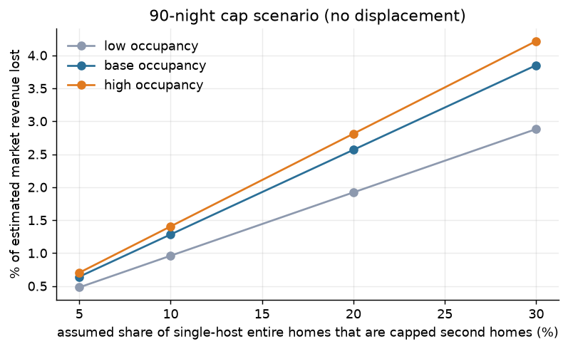

# Scenario: a 90-night annual cap on self-used second homes

> **This is a clearly labelled SCENARIO, not legal advice and not a forecast.** It asks: *if* a 90-night cap applied to some share of listings, how much estimated supply and revenue would that touch? The data cannot tell which listings are second homes, so the share is an explicit assumption.

## What the rules say (described cautiously - verify official sources)
- Berlin restricts converting residential space to holiday rental under the *Zweckentfremdungsverbot-Gesetz* (ZwVbG). Short-term accommodation units are identified by a **registration number** (a unit-specific identifier).
- The official Senate page (berlin.de/sen/wohnen/rechtliches/zweckentfremdungsverbot/, read 23 Nov 2026) states that a fourth amendment of the ZwVbG, implementing the EU short-term-rental regulation, entered into force in **2026**, and refers to a **self-used Berlin second home rented out for at most 90 days per year**.
- Secondary websites we looked at disagree with each other on who the 90-day limit applies to (some apply it to main residences), so **this project does not rely on them**. Exact scope, exceptions, start dates and fines must be checked on the official page or with the responsible district office.
- The scenario below uses only the narrow reading 'self-used second home, at most 90 nights per year' as a modelling device.

## Method (assumptions you can change in `src/scenario_cap.py`)
- **Pool:** entire-home benchmark listings of single-listing hosts: **1,741** of 4,478 entire homes (39%). Hosts with several listings are assumed to operate commercially and are outside the pool.
- **Share assumed to be capped second homes:** 5%, 10%, 20%, 30% (unknown; this is the key sensitivity).
- **Effect:** a capped listing keeps `min(estimated nights, 90)` and loses `price x (nights - 90)`. Nights come from the review-based occupancy estimate (low/base/high), so they are estimates.
- **Displacement:** 0% (lost nights vanish) or 50% (half are re-booked by other entire homes in the same district, limited by their spare capacity up to the model's 255-night cap).
- Limits: no price response by hosts or guests, no change in registrations, no enforcement/compliance modelling, snapshot of 19 Sep 2026, and the licence field cannot identify second homes.

## Results (base occupancy scenario)

In the pool, **57%** of listings have more than 90 estimated nights per year; the mean estimated nights above the cap per pool listing is **66**.

| Assumed capped share | Lost nights/yr (no displacement) | Lost revenue EUR m | % of market est. nights | % of market est. revenue | % revenue lost with 50% displacement |
|---|---|---|---|---|---|
| 5% | 5,784 | 1.1 | 0.6% | 0.6% | 0.3% |
| 10% | 11,567 | 2.1 | 1.2% | 1.3% | 0.5% |
| 20% | 23,135 | 4.3 | 2.4% | 2.6% | 1.1% |
| 30% | 34,702 | 6.4 | 3.6% | 3.9% | 1.6% |

### Sensitivity to the occupancy model (20% share, no displacement)

| Occupancy scenario | % of market est. revenue lost |
|---|---|
| low | 1.9% |
| base | 2.6% |
| high | 2.8% |

### Districts most affected (base, 20% share, no displacement)

| District | Pool listings | Pool over 90 nights % | Lost revenue EUR m |
|---|---|---|---|
| Mitte | 313 | 62% | 0.92 |
| Friedrichshain-Kreuzberg | 324 | 57% | 0.90 |
| Pankow | 307 | 64% | 0.86 |
| Charlottenburg-Wilm. | 167 | 60% | 0.44 |
| Neukölln | 167 | 49% | 0.27 |

## Host-level view

A host with a self-used second home earning from 200 nights at a given price would, under a 90-night cap, need a nightly price of about `200/90 = 2.2x` to keep revenue, which is far above what comparable listings charge. `RevenueCalculator.estimate(Profile(..., max_nights=90))` returns this break-even price and the capped revenue range.

## How to read this

- The result is an **order of magnitude under stated assumptions**, not a prediction of what the rule does.
- The biggest unknown is the share of second homes; the table shows how fast the answer moves with it.
- Because occupancy is estimated from reviews (and capped at 255 nights), absolute nights are uncertain; the ranking across districts is more reliable than the levels.
